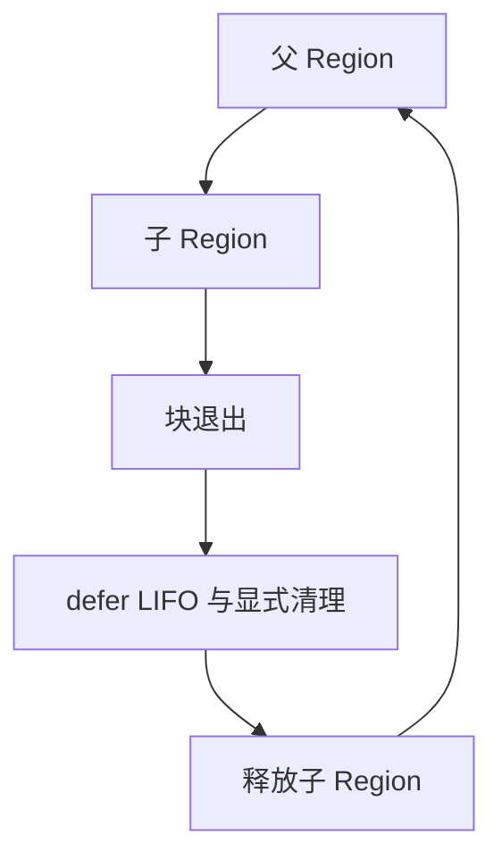

# Historical Lexical Region Memory Proposal

**状态**: 已被 2026-11-19 GC-first v1 内存决策取代。本文保留当时的 Region 方案讨论，
不再定义当前语言契约，也不是 v1 待实现计划。当前规则见 `doc/memory.md`。

## 决策

Do 的目标内存模型使用词法作用域管理显式分配：在某个代码块中创建的分配属于
该块；退出该块时统一释放。函数参数默认只读借用，调用本身不转移分配的管理责任；
没有 owner 接管参数这一机制。

```do
{
    s = allocate_slice(u32, 8)
    use(s)   // 同步借用；返回后 s 仍归当前块
    use2(s)  // 可以继续借用
} // 释放此块拥有的分配
```

`_ = s` 只丢弃表达式结果，不表示释放。分配的释放由创建它的词法块负责，且
只发生一次。嵌套块可以借用外层块的分配；外层块必须活到所有借用结束。

普通值赋值 `old = p` 产生逻辑独立副本，之后修改其中一份不影响另一份；整数等标量直接
支持变量间赋值和交换：

```do
a i32 = 1
b i32 = 2
t = a
a = b
b = t
```

变量赋值 `a = b` 是通用的复制语法，不额外提供 `copy`/`clone` 操作。普通 Do 值赋值
产生逻辑独立副本；编译器可以共享不可变存储，或对可变动态字段使用 COW，只要修改一份
不会影响另一份。复制结构体时，其动态字段在语义上递归复制并归目标变量所在的区域；
外部资源句柄字段仍复制句柄引用并共享同一个外部资源，不复制底层资源，也不转移资源状态。
函数参数仍可按默认规则借用句柄。

共享存储按生命周期分层：字符串字面量和编译器生成的只读常量进入全局只读区；运行时
生成的共享不可变存储进入仍存活的共享区域；如果编译器无法证明共享区域覆盖所有使用者
的生命周期，就把值复制到目标区域。共享存储不得依赖已退出的词法区域，不使用引用计数
堆，也不向 Do 源码暴露引用。

Region 的目标运行时表示是内部区域句柄和父子区域链。每个词法块进入时创建一个 Region，
Region 至少记录父 Region、分配游标、分配上限和清理栈：

```text
Region {
    parent
    allocation_cursor
    allocation_limit
    cleanup_stack
}
```

普通分配写入当前 Region；函数返回对象的隐藏结果槽位使用调用方 Region。块退出时，先
执行该 Region 的 `defer` 和显式清理，再释放该 Region 的全部存储。子 Region 退出后，父
Region 继续有效。Region 句柄和父子链只存在于编译器生成的内部 ABI，不暴露给 Do 源码。



共享不可变存储不得指向已经退出的子 Region；若无法证明共享者的生命周期覆盖该存储，
就在目标 Region 中复制。该规则不引入全局共享 Region 作为普通分配的默认归属。

```do
Person {
    name Text
    scores [i32]
}

{
    person Person
    {
        source = make_person()
        person = source
    } // source 及其动态字段结束

    use(@get(person, .name), @get(person, .scores))
} // person 及其动态字段一起结束
```

每次调用 `close(handle)` 都调用该资源类型提供的 close API。Do 不统一跳过重复调用、
强制错误或规定返回值：外部 API 有返回值就原样返回，没有返回值就没有返回值；重复关闭
是否报错、幂等或产生其他结果也由该 API 决定。资源类型负责其句柄/别名的关闭语义。

`@set` 是否产生新值由调用形式决定：作为赋值右侧并由左侧接收时产生新值；单独作为
语句调用时原地修改当前作用域中的可变变量。函数参数是只读借用，函数只能读取参数并
返回新值；调用方在拿到结果后显式执行 `@set`。不提供 `mut` 参数、`ref<T>` 或核心库
特权来绕过该规则。

`@set` 的实现采用路径复制；如果目标存储唯一且未逃逸，就在原地复用。存在仍可观察的
旧值时，只复制从对象根到被修改字段的路径，未修改字段继续共享；数组写入时复制其
可变 backing storage，`text` 等不可变内容可以继续共享。

```do
update(p Point) -> Point {
    return @set(p, .x, 9)
}

point = update(point)
print(@get(point, .x)) // 9
```

函数返回的新分配值提升到调用方接收变量所属的区域，不能在被调函数退出时释放。它与
嵌套块中 `dst = src` 的提升规则相同。WASI `File` 是外部资源句柄而非 Do 内存分配；
函数可以返回句柄，由调用方显式关闭：

```do
gen_file() -> File {
    return open_file("a.md")
}

{
    file = gen_file()
    close(file)
}
```

```do
make_person() -> Person {
    return Person{
        name = "Alice",
        scores = [10, 20],
    }
}

{
    person = make_person()
    use(person)
} // person 与其内部动态存储在此区域结束时释放
```

返回对象与其动态字段构成一个对象图。ABI 的隐藏结果槽位表示对象图的根，槽位和字段
存储都归接收变量所属的区域；字段不能脱离对象根单独逃逸或单独销毁。内部可以将字段
存储分开分配，但必须登记在对象根下，成功返回后由对象根统一管理。

```text
current_region
└── person
    ├── name
    └── scores
```

含动态字段的返回值使用调用方提供的隐藏结果槽位；标量和纯 inline 结构体继续使用普通
返回值。构造失败时，编译器清理已经初始化的字段和结果根，并返回声明的错误；不能留下
部分可用对象或悬空字段。该槽位和对象登记是内部 ABI 机制，不暴露给 Do 源码。

异步调用借用块内分配时，借用持续到 Future 被消费并进入终态。`@async` 创建独立任务，
不能假设 Future 未等待就意味着任务没有运行。Future 必须由 `@await` 或 `@cancel` 消费，
不能静默离开作用域；如果 owner 块将退出而 Future 仍借用其中的分配，编译器必须报错，
不隐式取消任务。调用方须在块退出前显式 `@await` 或 `@cancel`；`@cancel` 会等待异步 ABI
到达终态。带 timeout 的 `@await` 超时时自动取消任务，并等待异步 ABI 到达终态后再返回。
owner 块只有在借用结束后才能退出并释放分配。无 timeout 的 `@await` 返回任务声明的
`T | E`；带 timeout 的 `@await` 返回 `T | E | FutureTimeoutError`，其中
`FutureTimeoutError` 表示任务已取消
且清理到终态。

一个 Future 可以同时借用多个词法区域中的分配。它借用的每个区域都独立执行 owner
退出检查：若 Future 尚未终止就要退出任一被借用区域，编译器报错；不会因 async 借用而
自动把分配提升到更外层区域。

任务错误分为声明错误和未声明运行时故障。函数返回 union 中声明的业务错误作为 Future
的正常终态，由 `@await` 返回；取消和 timeout 走各自的终态清理路径。trap、ABI 违规等
未声明运行时故障先执行 Future、词法区域和外部资源的终态清理，然后直接终止当前任务或
程序，不转换为可由 `@await` 捕获的 `FutureRuntimeError`。业务错误必须显式写入函数返回
union。

未声明运行时故障的诊断使用固定字段：故障类别和原因、故障发生位置、任务创建位置、
`@await` 位置，以及清理状态。清理完成后再输出诊断；无法取得异步栈时，至少输出故障
位置和清理状态。该诊断属于运行时报告，不改变 `Future<T | E>` 的类型，也不把故障转为
可捕获错误。

区域退出清理函数必须返回 `nil`。可能失败的 `close` 或析构操作必须在注册 `defer` 前
显式调用并处理其返回值；`defer` 只登记不会返回清理错误的动作。没有返回值的外部清理
API 直接按其自身契约执行。清理阶段若发生未声明运行时故障，仍先完成剩余终态清理，
再按未声明故障规则终止当前任务或程序；不把清理错误隐式追加到原函数返回 union。

```do
{
    outer_data = allocate_slice(u8, 64)
    {
        inner_data = allocate_slice(u8, 64)
        task Future<T | E> = @async(send(outer_data, inner_data))
        @await(task)
    } // task 已终止，inner_data 可释放
    use(outer_data)
}
```

`FutureTimeoutError` 是标准单分支错误枚举：

```do
FutureTimeoutError error = FutureTimedOut
```

```do
run() -> nil {
    data = allocate_slice(u8, 1024)
    task Future<nil> = @async(send(data))
    return // 编译错误：task 尚未消费，仍可能借用 data
}
```

分配请求长度必须大于 0。分配失败返回带请求长度的 payload enum 错误，不使用 `0` 哨兵：

```do
AllocationError = OutOfMemory(usize)
```

错误分支携带实际请求长度；内部运行时与 Do 源码使用同一个错误值。分配失败时不登记
分配。分配函数返回分配值与 `AllocationError` 的 union；调用方要么显式处理错误分支，
要么在自己的返回 union 中包含 `AllocationError` 并显式返回它，不做隐式错误传播：

```do
make_data(size usize) -> [u8] | AllocationError {
    data [u8] | AllocationError = allocate_slice(u8, size)
    return data
}
```

错误向外传播或在本层处理时，仍执行已登记的区域清理。块退出顺序固定为：先按注册逆序
执行 `defer`，再执行必要的显式析构或资源关闭，最后回收整个区域的内存。`defer` 和析构
运行期间，区域内存仍然有效；因此清理代码可以访问该区域中仍存活的值。普通 Do 值不需要
逐个调用析构函数，区域整体回收负责释放其存储；文件、socket、stream endpoint 等外部
资源仍须由 `close`/`drop` 或 `defer close(...)` 显式处理。

例如：

```do
{
    data = allocate_slice(u8, 64)
    defer cleanup_a()
    defer cleanup_b()
} // cleanup_b(), cleanup_a(), 最后回收区域
```

WASI/Component resource 与 Do 分配区分处理。文件、socket、stream endpoint 等
外部资源仍由对应 API 的显式 close/drop 和 Component ABI 生命周期规则管理；
块结束释放 Do 内存不等于关闭外部资源。

## 设计边界

- 该模型不采用公开的 `own<T>`、`borrow<T>`、`ref<T>` 类型，也不提供参数 owner
  接管语义。
- `allocate_slice(u32, 8)` 仅为讨论中的示意写法，不代表当前已定语法或实现。
- 创建于内层块的分配不能逃出该块，除非赋值或函数返回将新值及其普通动态字段递归提升到
  接收变量所属的区域。如何由 ABI 将目标区域传入被调函数或提供返回存储仍需实现设计。
- Do 源码分配不再依赖 GC 可达性回收；Region 使用内部句柄和父子链，Wasm linear memory 的分配器和区域回收布局、
  区域内动态分配和资源析构细节均需要实现设计和验证。运行时是否在
  不参与 Do 源码值生命周期的内部用途保留 GC，属于 backend 实现选择。

## 尚未决定的源码语义

1. async 未声明运行时故障的诊断渲染和终止实现。报告字段已确定为故障类别/原因、发生
   位置、任务创建位置、`@await` 位置和清理状态；故障先完成统一终态清理，再直接终止
   当前任务或程序，不转换为 `FutureRuntimeError`。
2. 清理错误的具体诊断格式和外部 API 适配实现。清理函数必须返回 `nil`，可能失败的
   `close`/析构须在 `defer` 前显式处理，不把清理错误隐式追加到原函数返回 union；分配失败
   的 payload enum `AllocationError = OutOfMemory(usize)`、无 `0` 哨兵、显式 union 传播已确定。

已确定的条目定义目标源码契约；尚未完成的 ABI、诊断和运行时细节仍需设计验证。

## 取代关系

本文取代 `doc/design/2026-08-11-gc-first-memory-decision.md` 作为目标内存模型决策。
GC-first 文档中的测试结果、Wasm GC backend 与 Component gate 仍是当前实现证据；
它们不再定义目标源码契约。迁移计划必须单独审查 GC 实现、WASI/Component ABI 和
异步生命周期之间的兼容性。
