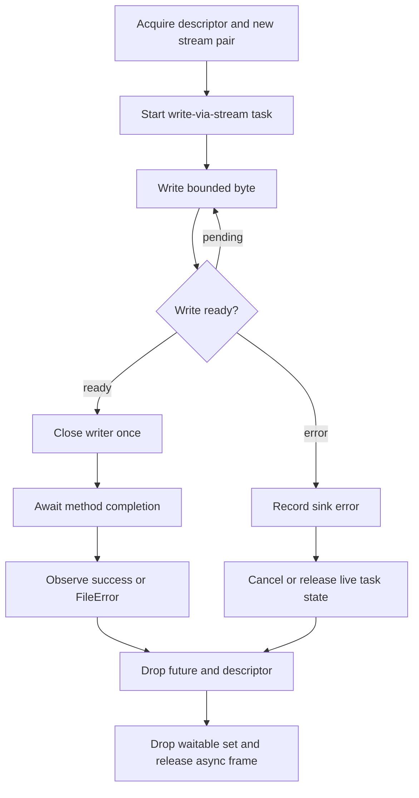

# D2 Filesystem `descriptor.write-via-stream` Private Boundary

Date: 2026-11-21
Status: design approved for ABI probe and bounded implementation

## Intent

Add one measured Preview 3 filesystem capability for writing a finite byte
stream at a fixed file offset:

```wit
descriptor.write-via-stream: async func(
    data: stream<u8>,
    offset: filesize,
) -> result<_, error-code>;
```

The capability is useful because it exercises the next D2 boundary after the
completed producer lifecycle work: a filesystem resource method owns a guest
producer stream, returns an asynchronous completion, and can fail while the
stream is still active. The implementation must make every handle and every
task transition explicit.

The source of truth is the pinned WIT package at
`src/build/p3_wit/wasi-http-0.3.0-rc-2025-09-16/deps/filesystem/types.wit`.
Its SHA-256 is pinned by the ABI probe.

## Selected boundary

The compiler admits one private declaration shape:

```do
write_via_stream = @host_async_func(
    "wasi:filesystem/types@0.3.0-rc-2025-09-16",
    "descriptor.write-via-stream",
    (File, StreamWriter<u8>, u64) -> Result<nil, FileError>,
)
```

`File` mirrors the fixed `filesystem/types/descriptor` resource and
`FileError` mirrors the filesystem `error-code` enum used by the existing
filesystem gates. The method is called at most once per probe invocation. The
source creates one `new_stream<u8>(1)` pair, transfers the writer to this
method, performs a fixed finite number of literal byte writes, awaits every
write, closes the writer exactly once, and awaits the method completion.

The private bounded source shape is deliberately narrow:

```do
pending Future<Result<nil, FileError>> = write_via_stream(file, writer, offset)
pending_write Future<Result<nil, StreamError>> = writer(value)
write_result Result<nil, StreamError> = @await(pending_write)
completion Result<nil, FileError> = @await(pending)
```

The actual fixture fixes the permitted write count and byte value after the
ABI probe. A zero-write case is included only if the measured stream contract
proves that closing an unused writer is valid. The probe `run` returns `nil`:
`StreamError` and `FileError` are observed by the controlled host and asserted
by the lifecycle runner, rather than being mapped into one source-level error
union in this step. The default route remains fail-closed when the exact
method, stream shape, or ABI descriptor is absent.

## Goals

- Measure and pin the Core ABI generated from the exact filesystem WIT.
- Add a private, bounded `descriptor.write-via-stream` Component lowering.
- Track descriptor, writable stream, async method task, per-write future, and
  waitable state with exactly-once cleanup.
- Cover ready, pending, sink error, method completion error, cancellation, early store drop, and
  repeated invocation in the Rust/Wasmtime gate.
- Preserve the rule that cancellation releases guest state but does not claim
  to roll back bytes already accepted by the filesystem host.
- Keep the implementation isolated from generic filesystem async lowering.

## Non-goals and anti-goals

- No `append-via-stream`, generic filesystem async, arbitrary producer
  expressions, unbounded stream loops, or borrowed stream payloads.
- No public `own<T>`, `borrow<T>`, or `ref<T>` syntax.
- No reuse of the CLI stdout writer method's method import or result layout
  without an independent WIT-derived measurement.
- No promise that cancelling an in-progress write undoes an external file
  mutation.
- No compatibility fallback for an older or unmeasured wasm-tools ABI.

## Approaches

### Generic filesystem async lowering

This would share a broad lowering path for resource methods, streams,
futures, result areas, cancellation, and arbitrary payloads. Existing evidence
does not establish a stable contract for those combinations. It would expand
the admission surface and make a local ABI mistake affect unrelated routes.
Rejected for this step.

### Reuse the CLI `write-via-stream` emitter

The CLI route has no descriptor receiver and its method identity, async task
return, and error ownership are different. Copying its ABI would hide the
filesystem receiver and offset contract. Rejected.

### Dedicated filesystem writer route

Measure this exact method, register only the measured shape, and add a
dedicated plan/emitter with a bounded source grammar. This keeps the contract
reviewable and lets later routes share helpers only after their Core ABI and
lifecycle facts match. Selected.

## ABI measurement gate

Before changing the registry or production emitter, the probe must establish:

- the `[async-lower][method]descriptor.write-via-stream` import name;
- descriptor, `stream<u8>` writer, and `u64` offset Core argument order;
- method result-area or direct result representation for `result<_, error-code>`;
- stream creation, writable stream write, writable stream cancel, and stream
  drop imports;
- method task return and cancellation imports;
- per-write future creation, polling, cancellation, and drop imports if the
  pinned adapter emits a future for the stream write;
- resource-drop behavior for `descriptor`;
- canonical result layout for method success and filesystem error;
- the exact pinned WIT hash and toolchain version used for the observation.

The committed probe must fail on a changed import name, Core parameter/result
list, WIT hash, or required lifecycle import. Until it passes, the compiler
must not admit this method.

## Lifecycle contract



The frame owns the descriptor until the method path transfers or releases it,
the writer until the method accepts it, the current write future while a write
is pending, the method completion future, and the waitable set/task context.
Each nonzero handle reaches its matching cancel/drop operation at most once.
The source registers `defer close(writer)` before transferring the writer to
the method. The defer runs after the completion await and is the single source
level writer termination. A sink error does not cause a second close or a
second future drop.

Cancellation is state cleanup only. It must cancel pending guest Component
state and release guest-owned handles; it does not report that a filesystem
write was rolled back.

## Test matrix

| Case | Required evidence |
| --- | --- |
| ready | bounded bytes accepted, completion observed, writer/future/descriptor each dropped once |
| pending write | wake and resume, then the same exactly-once cleanup |
| sink error | `StreamError` observed by the controlled host, writer and method state released once |
| method completion error | `FileError` observed by the controlled host, no duplicate writer or descriptor cleanup |
| cancel before write completion | task cancellation reaches live state, no use-after-drop |
| cancel after writer close | completion state is released correctly; no rollback claim |
| early store drop | no post-disposal access; assertions stop at store disposal boundary |
| repeat | two independent invocations have independent frames and cleanup counts |

## Files expected during implementation

- ABI probe WIT, Core WAT, and shell gate under `examples/p3-runtime/`.
- A method-specific Component emitter and template under `src/build/`.
- One registry shape and compiler target admission after the ABI gate passes.
- Positive and negative compiler fixtures under `src/build/test/`.
- Rust/Wasmtime lifecycle runner and its shell gate.
- Synchronized status entries in `doc/pending_blocked.md`,
  `doc/roadmap_status.md`, `doc/start_here.md`, `doc/master_plan.md`, and
  `CHANGELOG.md`.

## Toolchain limitation recorded by the ABI probe

`wasm-tools 1.263.0` emits the standard dummy `stream.forward` import for
this resource method, but the current `wasm-tools component new` and Wasmtime
51.0.0 validation path rejects the encoded `stream.forward` instruction as
requiring the component-model forward feature. The compiler-generated D2
routes use their measured direct Core imports and omit that unused forward
operation, which is why existing CLI writer routes remain assembleable. This
method must therefore pass a compiler-generated Core WAT assembly and runtime
gate before registry admission. The dummy-template snapshot alone is not
evidence that the route is executable.
