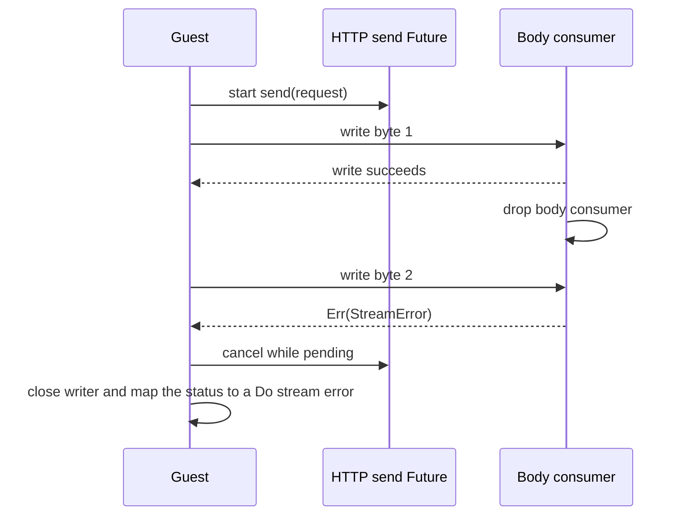

# G6.2 HTTP Body Producer Write Error Design

## Intent

Extend the existing private guest-produced HTTP body probe with one deterministic
writer-failure path. The probe must preserve a `StreamError` instead of ignoring
it, cancel the still-pending HTTP send, and clean up the writer, stream, request,
and Future exactly once.

## Current Evidence

- `examples/p3-runtime/http-request-body-producer-send-first.do` awaits each
  `writer` result but discards both results.
- `examples/p3-runtime/test_rust_http_request_body_producer.sh` currently checks
  successful payload writes and HTTP completion only.
- `doc/host_abi_blockers.md` lists producer error mapping as outside the admitted
  surface.
- The pinned Component stream is rendezvous-based. The host test can drop its
  body consumer after the first accepted byte, making the next write fail.

## Approaches

1. Keep ignoring `StreamError`. This preserves the existing probe contract but
   can report a successful HTTP result after a body write failed.
2. Map writer failures to `HttpError`. This keeps one error type but loses the
   source of the failure and invents an HTTP error mapping.
3. Map the writer status into the two Do `StreamError` cases. This keeps the
   closed-stream condition distinct from other non-success outcomes.

Selected: approach 3. The user approved reporting the writer failure as a
separate error from `HttpError`.

## Design

- Add a separate private failure probe; keep the existing successful body probe
  and its accepted source shape unchanged.
- Keep the body source finite and fixed. No loop, arbitrary producer
  expression, dynamic body buffer, or public ownership syntax is added.
- The failure host mode accepts the first byte, drops the body consumer, and
  keeps the HTTP send Future pending until the guest cancels it. This prevents a
  send-completion race from turning the failure test into cancel-after-terminal.
- On the failed writer result, the guest stops writing, cancels the send Future,
  closes the writer once, and returns the matching `StreamError` variant.
- Wasmtime stream `ReturnCode` low bits use 1 for `Dropped` and 2 for
  `Cancelled`. The probe maps `Dropped` to `StreamClosed` and maps `Cancelled`
  coarsely to `StreamWriteFailed`; this does not preserve a WIT error payload.
  Unknown nonzero values trap instead of being relabeled.
- The private exported result carries the existing HTTP error and the two Do
  `StreamError` cases as distinct WIT error variants. The pinned HTTP import ABI
  and the public `lib/http.client.do` surface do not change.
- Failure-mode assertions require one accepted byte, no response, one send
  cancellation, one drop for each live Future/stream/request endpoint, and an
  empty `ResourceTable`. The existing success gate continues to assert the
  complete `[65,66]` payload.

## Non-Goals

- Dynamic or unbounded HTTP body production.
- General producer error mapping for all G6.2 shapes.
- General cancellation of arbitrary host calls or concurrent requests.
- Changes to public HTTP APIs, general WIT lowering, or the GC migration matrix.

## Acceptance

- A deterministic Component/Rust/Wasmtime test observes the original writer
  error and exactly-once cleanup on failure.
- The existing successful HTTP body producer gate remains green and unchanged
  in behavior.
- Unsupported source shapes still fail before WAT emission.
- The probe WIT, source fixture, manifest/source matcher, negative fixtures,
  documentation, and runtime gate agree on the new bounded contract.
