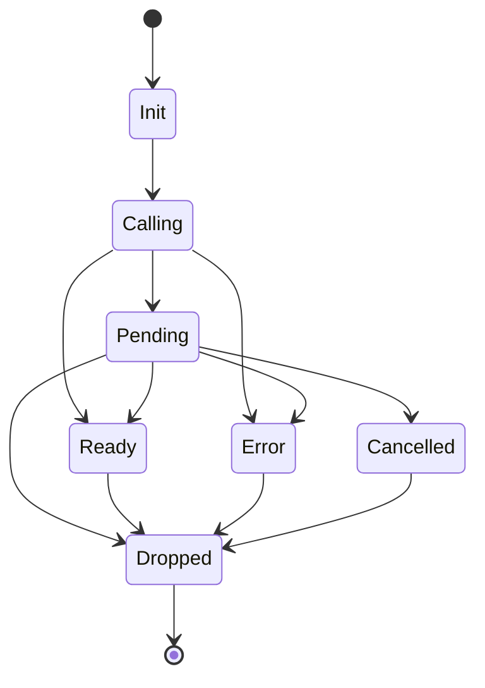

# G6.2 Generic Producer and Resource Lifecycle Design

Status: draft for review
Date: 2026-11-21
Decision: route B, establish a shared foundation and widen capability in measured phases

## 1. Intent

G6.2 is intended to make async producers and Component resources reusable across
multiple payload shapes while preserving the lifecycle guarantees already proved
by the private routes. The immediate problem is not a missing single WIT probe.
The compiler already has measured direct-record, multi-owned, nested, list,
scalar, mixed, dynamic, batched, HTTP error, and cancellation routes. The problem
is that those routes still depend on route-specific adapters, source matchers, and
emission assumptions.

This design establishes one internal producer/resource contract and one lifecycle
state machine. It then widens the supported shapes one family at a time. Public
ownership syntax and general host I/O remain separate decisions.

The repeated rework came from three causes:

1. A passing private route was treated as evidence for a neighboring generic
   shape, even when the payload layout or Component toolchain behavior differed.
2. Source admission, payload layout, ownership transfer, and terminal cleanup
   were represented in different route adapters instead of one validated plan.
3. Cancellation, early drop, repeat invocation, and partial writes were tested
   after code generation decisions had already been made.

G6.2 will be considered broadly usable only when a new supported shape is lowered
from the shared contract and passes the same ABI, Component, and lifecycle gates.

## 2. Current evidence and constraints

The following are facts from the current repository state:

- `ProducerContract`, `PayloadLayout`, `OwnershipTransferPlan`, and
  `TerminalContract` already exist in
  `src/build/codegen_component_producer_contract.zig`.
- `LifecycleStateIR` already validates canonical frame facts, complete-write
  transfer, reverse cleanup, terminal ordering, and the rule that cancellation
  does not roll back host effects in
  `src/build/codegen_component_producer_state_ir.zig`.
- Runtime audit and lifecycle probe tests already cover the established private
  routes. Their evidence is recorded in `doc/master_plan.md`,
  `doc/design/2026-08-03-g6-2-general-resource-ownership.md`, and the focused
  `examples/p3-runtime` gates.
- The current status is `complete_rows=15 pending_rows=0` for the G5c inventory.
  Historical text containing `complete_rows=15 pending_rows=15` is not current
  status. The current blocked boundary is recorded in `doc/pending_blocked.md`.
- The production memory model is GC-first. Ordinary Do values are not released
  at lexical block exit. Component resources, futures, streams, and external
  handles retain explicit ABI cleanup contracts. This design does not reopen the
  removed ARC or region-memory model.
- Component capability is version-specific. A private route's pinned WIT,
  `wasm-tools`, and Wasmtime evidence must remain attached to that route. A
  successful canonical probe does not prove a generic compiler lowering.

The following constraints apply to every phase:

- Do not add public `own<T>`, `borrow<T>`, or `ref<T>` syntax.
- Do not infer support for borrowed, list, variant, nested, or mixed resource
  payloads from a neighboring route without a measured ABI and runtime gate.
- Do not combine this work with D2 generic filesystem async, external HTTP
  provider generalization, GC migration inventory, root hard-cancel, or arbitrary
  producer expressions.
- Do not claim rollback of an external host side effect when cancellation occurs.
- Preserve fail-closed behavior for unknown descriptors, unknown status values,
  malformed lengths, duplicate release, and incomplete transfer.
- Keep the default compiler route unchanged until promotion criteria in this
  document are met.

## 3. Goals

1. Define one immutable internal contract for source, sink, payload layout,
   ownership transfer, and terminal cleanup.
2. Define one lifecycle state machine for future, stream, producer lease, and
   resource cleanup.
3. Make repeat invocation and loop iteration use independent lifecycle frames.
4. Make partial writes and ownership transfer atomic at a declared commit point.
5. Reuse the same validation and emission model for each newly admitted shape.
6. Keep unsupported shapes rejected at the layer where the limitation is known.
7. Make each phase independently reviewable, testable, and stoppable.

## 4. Non-goals

- Public ownership types or pointers in Do source.
- A general async expression system.
- Generic filesystem or HTTP provider support.
- Automatic cancellation or rollback of arbitrary host side effects.
- Reopening ARC, lexical region release, or manual management of ordinary GC
  values.
- Treating a private WIT probe as a public source-language feature.
- Supporting every WIT shape in one release.

## 5. Anti-goals

The implementation is a failure if it:

- adds another route-specific emitter while calling it generic support;
- silently accepts a shape that the pinned Component toolchain rejects;
- has different cleanup rules for scalar, record, and list routes without an
  explicit contract reason;
- allows a second transfer, double terminal cleanup, or use after transfer;
- reports success while a supported terminal path leaves a live resource table;
- changes ordinary GC value semantics as a side effect of G6.2.

## 6. Approaches considered

### A. Continue adding bounded private slices

Each new shape gets its own descriptor, source matcher, ABI fixture, emitter
branch, and Rust/Wasmtime runner.

This gives fast evidence for one exact shape and preserves tight admission
boundaries. It does not solve the current source of rework: shared lifecycle and
layout rules remain duplicated. It also makes the gap between private evidence and
generic language support grow over time.

### B. Build a shared foundation, then widen by shape family

First normalize existing routes into one contract and lifecycle IR. Then add
shapes in a fixed order, each with a measured canonical ABI, compiler admission,
negative fixtures, Component validation, and runtime cleanup matrix.

This takes longer before a new public capability appears, but it turns existing
evidence into reusable compiler infrastructure and keeps every expansion bounded.
It is the selected approach.

### C. Stop expansion and maintain the current private routes

This minimizes implementation risk and preserves the current evidence. It leaves
G6.2 blocked as a product capability and does not address the need for a common
producer/resource lowering.

The project selected B because G6.2 should progress, while the prior route-by-route
method has already reached the point of diminishing returns.

## 7. Unified lifecycle contract

The contract is internal IR. It does not become a source-level ownership type.

### 7.1 States



The states mean:

| State | Meaning | Allowed effect |
| --- | --- | --- |
| `Init` | Frame and ownership slots have been initialized | acquire or call |
| `Calling` | Host operation or producer callback is being started | complete, become pending, or fail |
| `Pending` | A future, stream, subtask, or waitable remains live | poll, cancel, or drop |
| `Ready` | A result or completion is available | decode and commit, or fail validation |
| `Error` | The operation ended with a typed or mapped error | release owned values and terminate |
| `Cancelled` | Cancellation was requested and acknowledged by the private route | release live component state and terminate |
| `Dropped` | All cleanup actions for this frame are complete | no further use |

`Dropped` is a lifecycle terminal state, not a statement that an arbitrary host
side effect was undone. Unknown nonzero status values fail closed before they can
be interpreted as a valid terminal state.

### 7.2 Frame isolation

Every producer call, loop iteration that starts an async operation, and repeated
instance call receives a separate lifecycle frame. A loop executed 100 times can
therefore register 100 cleanup obligations, one per iteration. A frame cannot
reuse another iteration's presence mask, resource slot, future handle, or
terminal marker.

The frame is released only after its operation reaches a terminal state and all
children have been released. Dropping a parent waitable while it still owns a
child endpoint is invalid.

### 7.3 Ownership and transfer

The contract records each resource leaf path, handle offset, drop import, and
presence bit. A resource handle value of zero is a valid handle and cannot be
used as an absence sentinel.

The transfer commit point is after the complete payload has been written and
validated. Before the commit point, the guest frame owns every present leaf and
must release them in reverse acquisition order on failure. At the commit point,
the complete group is transferred atomically. After the commit point, host-side
cleanup authority owns the transferred leaves; cancellation does not move that
authority back to the guest.

For nested payloads, child leaves are released before parent containers. For a
list payload, the list backing allocation is a separate cleanup stage from its
resource elements. The contract must state both stages and their order.

### 7.4 Terminal cleanup

The terminal contract declares close, abort, cancel, and cleanup stages. A
terminal path executes each applicable action at most once. The expected order is
child resources, list backing, stream, future, subtask, waitable, then frame,
with the actual order validated against the payload topology and route contract.

The contract does not promise that close returns a universal result type. A host
operation may expose a result or no result; the adapter must preserve the host
ABI and map only documented statuses. Unknown status is an error.

### 7.5 Cancellation and early drop

Cancellation and early drop are distinct observations even when they share
cleanup code. Cancellation requests termination of a live operation. Early drop
disposes a store or frame before completion. Both must release live Component
resources exactly once, but neither compensates a host effect already issued.

## 8. Contract and lowering model

The shared `ProducerContract` is extended only through explicit fields and
validation, not by bypassing existing route adapters.

It has five conceptual sections:

1. `SourceContract`: module, import, core parameters, and core results.
2. `SinkContract`: endpoint member, capacity, read/write imports, and drop
   import.
3. `PayloadLayout`: scalar, record, list, and later variant forms, including
   offsets, sizes, alignment, stride, length limits, and allocation release.
4. `OwnershipTransferPlan`: leaf paths, parent presence bits, complete-write
   requirement, commit groups, and reverse pre-transfer cleanup.
5. `TerminalContract`: close, abort, cancel, and ordered cleanup stages.

The sema layer produces a normalized source and lease plan. The codegen layer
validates the plan against a pinned descriptor hash and creates the canonical
frame map. The emitter consumes the lifecycle IR and emits the same state
transitions for every admitted shape. Route-specific adapters are retained only
as input decoders or compatibility shims until their behavior is represented by
the shared contract.

The lowering boundary is:

```text
Do source / registered descriptor
        |
        v
source + payload + ownership + terminal facts
        |
        v
validated ProducerContract
        |
        v
canonical frame map + LifecycleStateIR
        |
        v
Core Wasm / Component lowering
        |
        v
ABI, validation, and runtime cleanup gates
```

No emitter may infer ownership from a field name, a numeric handle, or a source
expression after normalization. Missing layout or cleanup facts reject the route.

## 9. Phased delivery

### Phase 0: baseline and documentation closure

Freeze the current private route inventory, route-specific evidence, pinned tool
versions, and current rejection boundaries. Mark historical counts as historical
and make `doc/pending_blocked.md`, `doc/master_plan.md`, `doc/start_here.md`, and
`CHANGELOG.md` agree on the same status.

Acceptance:

- Current default, WASM, ReleaseSmall, and focused G6.2 gates are recorded with
  fresh outputs when this phase is implemented.
- No document claims generic producer/resource support from a private route.
- No code changes are needed to declare Phase 0 complete.

### Phase 1: lifecycle state machine

Move lifecycle decisions into one validated internal model. Cover producer lease,
stream, future, subtask, waitable, resource, cancel, early drop, repeat, and
terminal cleanup. Preserve existing route output and diagnostics.

Acceptance:

- Unit tests reject duplicate terminal action, transfer before complete write,
  partial group transfer, parent-before-child cleanup, and post-transfer rollback.
- Branch joins and loop exits cannot produce an unclassified lifecycle state.
- Existing private route WAT markers and runtime cleanup counts are unchanged.

### Phase 2: payload and ownership lowering

Replace route-specific layout assumptions with shared payload layout, presence
mask, ownership path, commit group, list allocation, and terminal cleanup IR.
Start with the already verified scalar, direct owned record, fixed multi-owned,
mixed scalar/owned, nested, and list routes as golden implementations.

Acceptance:

- Each golden route is emitted through the shared contract and still matches its
  pinned ABI/WIT hash and expected WAT markers.
- A malformed or incomplete contract fails before WAT emission.
- Canonical/generated Component parity and Rust/Wasmtime lifecycle parity remain
  green for every migrated route.

### Phase 3: staged shape admission

Add one shape family per reviewed implementation plan, in this order unless new
evidence changes the order:

1. scalar and owned record payloads;
2. nested owned record payloads;
3. list payloads with explicit allocation and element cleanup;
4. variant payloads with a measured tag/payload layout;
5. borrowed payloads only if the pinned Component toolchain accepts the exact
   async shape;
6. dynamic producer expressions only after source admission and bounded runtime
   semantics are specified.

Each family gets a positive route, compile-time negative fixtures, canonical WAT,
Component validation, ready/pending/error/cancel/early-drop/repeat rows, and
`ResourceTable` cleanup evidence. A family is not enabled by increasing a bound
or adding a matcher exception.

### Phase 4: promotion review

After at least two shape families use the same contract without route-specific
ownership emission, review whether the shared route can become the default
internal path. Public syntax and general D2 async remain separate promotion
decisions.

Promotion acceptance:

- all supported families use the same contract and lifecycle emitter;
- unsupported neighboring shapes still fail at the documented layer;
- no legacy ARC or ordinary GC behavior enters the production dependency graph;
- full default and WASM regression, ReleaseSmall smoke, focused ABI, and runtime
  cleanup gates are green;
- documentation names the exact supported shapes and evidence versions.

## 10. First implementation boundary after approval

The first implementation plan must be a foundation plan, not a new public feature.
It should migrate one existing scalar route and one existing direct-owned-record
route to the normalized contract and state IR. These two routes exercise both a
payload without resource leaves and a payload with one transfer group, while
keeping the ABI surface small.

The first plan must not add:

- a new public type or source keyword;
- a new WIT ownership shape;
- borrowed or variant async fields;
- general async function composition;
- arbitrary producer expressions;
- D2 or external provider behavior.

The first plan stops if either golden route changes its WIT hash, canonical frame
offsets, cleanup count, or negative diagnostic without a separately reviewed
contract change.

## 11. Verification contract for every later phase

Every new shape must provide all of the following before admission:

| Layer | Required evidence |
| --- | --- |
| Source | positive fixture and source matcher/registry contract |
| Sema | invalid transfer, reuse, branch/loop, and missing-fact diagnostics |
| Core ABI | parameter/result layout, offsets, alignment, and bounds |
| Component | pinned WIT hash, embed/new/validate result, canonical parity |
| Runtime | ready, pending, error, cancel, early drop, and repeat |
| Cleanup | exact resource/future/stream/subtask drops and empty table where applicable |
| Docs | status, boundary, tool versions, and known limits |

If a layer cannot observe a fact, the phase records it as unknown and does not
promote the shape. A host-side synthetic payload test may prove ABI decoding, but
it does not prove a production provider can generate that payload.

## 12. Stop, rollback, and scope rules

- Stop a phase when the same lifecycle invariant requires a route-specific
  exception. Revisit the contract before adding another exception.
- Roll back only the phase's admission and lowering change; retain canonical
  probes and diagnostics as evidence.
- Do not relax a negative test to make a positive route pass.
- Do not raise nesting, forwarding, item-count, or payload bounds without a new
  ABI and runtime design.
- If pinned `wasm-tools` or Wasmtime behavior changes, freeze the route and rerun
  its capability matrix before changing compiler semantics.
- If a change touches ordinary GC semantics, split it into a separate design.

## 13. Documentation migration

This specification becomes the current G6.2 direction after approval. Existing
route-specific design documents remain evidence records. The implementation plan
must update only the current status sections of `doc/pending_blocked.md`,
`doc/master_plan.md`, `doc/start_here.md`, and `CHANGELOG.md`; historical evidence
must retain its original date and counts.

The next plan will link each implementation task to this document and list the
exact source, test, and documentation files it changes. No implementation begins
until this design is approved.

